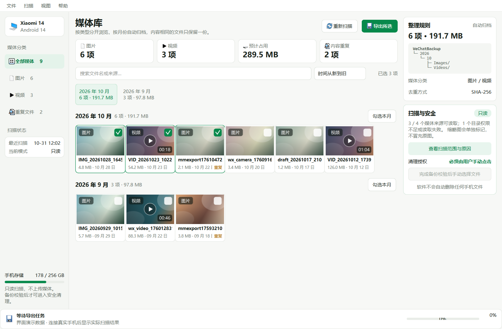

# WeChat Files Organize

Windows 桌面工具，通过 USB 和 ADB 读取 Android 手机中可访问的微信图片与视频，按月份整理、按内容去重并安全导出。



## 当前状态

这是首个可运行版本，重点完成桌面界面和核心数据流程：

- Windows / PySide6 桌面界面
- ADB 设备识别与 Android / 微信版本读取
- 微信候选媒体目录探测
- 图片和视频浅层分类
- 按月份分组浏览、搜索、筛选和多选
- 后台扫描与真实进度
- SHA-256 内容去重
- 按 `年/月/图片|视频` 导出
- 扫描能力报告
- 手动安全清理入口（默认锁定）

聊天记录中尚未保存到公共存储的媒体仍受 Android 权限限制。工具不会使用 Root、破解、数据库解密或 AI 上传绕过限制，也不会承诺提取全部聊天媒体。

## 开发环境

- Windows 10/11
- Python 3.11+
- Android Platform Tools（ADB）

```powershell
python -m venv .venv
.\.venv\Scripts\python -m pip install --upgrade pip
.\.venv\Scripts\python -m pip install -e ".[dev]"
```

## 运行

连接 Android 手机并开启 USB 调试后：

```powershell
.\.venv\Scripts\python -m wechat_media_exporter
```

使用示例数据预览界面：

```powershell
.\.venv\Scripts\python -m wechat_media_exporter --demo
```

生成界面截图：

```powershell
.\.venv\Scripts\python -m wechat_media_exporter --demo --screenshot screenshots/main.png
```

## ADB

程序会依次查找：

1. `tools/adb/platform-tools/adb.exe`
2. `tools/adb/adb.exe`
3. 系统 `PATH` 中的 `adb`

可运行以下命令下载官方 Android Platform Tools 到项目的忽略目录：

```powershell
.\scripts\fetch-adb.ps1
```

## 测试

```powershell
.\.venv\Scripts\python -m pytest
```

## 当前限制

- 首版只读取普通 ADB 权限可访问的目录。
- 无扩展名文件会以“待识别”状态保留，不会直接当作原图。
- 去重只在已有文件哈希和新导出文件哈希之间执行，不会把相似图片误判为重复。
- 手机文件清理功能尚未开放；必须先完成导出与双重校验，再由用户手动选择文件。

